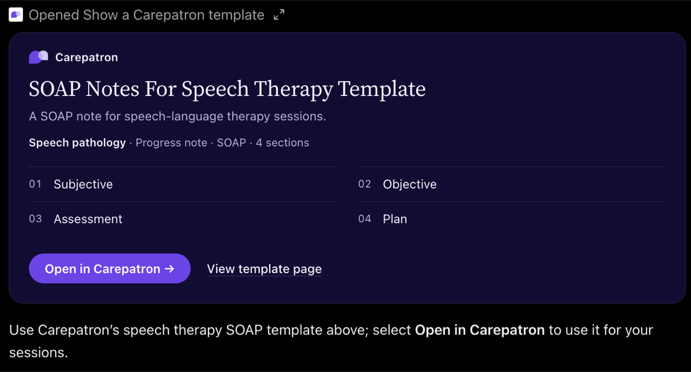

# Carepatron for ChatGPT

Clinicians already ask ChatGPT for SOAP notes, intake forms, consent forms and treatment plans. This plugin answers with Carepatron's own template, the next step to take with it, and a button that opens it in their Carepatron workspace.

**[See it without installing anything →](https://carepatron-chatgpt-plugin.jacksonirby.workers.dev/demo?template=counseling-intake-form)**



## Added 11 October 2026, for the Carepatron growth challenge

The server and the card were built the week before. These came out of the challenge's trial data, where practices that got a real client onto the platform in their first 14 days (intake form sent, booking taken, invoice, video call) paid at about three times the rate of those that didn't, and the most common first client touch was an intake form.

- **A landing page and a no-install demo.** [carepatron-chatgpt-plugin.jacksonirby.workers.dev](https://carepatron-chatgpt-plugin.jacksonirby.workers.dev) explains it; `/demo?template=counseling-intake-form` renders the real card in a browser tab, so you can see it without ChatGPT developer mode.
- **Eight more templates, the new-client pack.** Intake forms for counselling, physio, nutrition and general practice; informed consent, telehealth consent and the AI consent form; a cancellation policy. 18 in total.
- **A next step on every card.** Intake forms say: open it in Carepatron, add your client's email, send. That is the journey's ask, delivered where the clinician already is.
- **A third tool, `intake.checklist`.** What a new-client pack should include, by profession group and country (US, AU, NZ, GB, CA), with wording to adapt. The consent item is country-specific, drawn from what the APA, ACA, ASHA, APTA, Ahpra, RACGP, APS, MCNZ, the NZ Psychologists Board, NHS England, BACP and the Ontario IPC publish. It says in every reply that it is not legal advice.
- Tests went from 37 to 98. About two hours of work.

**Found along the way (two broken links on carepatron.com):** the Therapy Cancellation Policy template page's Download button points at `files/ace-test.pdf`, an unrelated file, so that template ships without a PDF link. The BIRP note page's Download link points at a `.pdff` that 404s (the file is there as `.pdf`).

## Why

ChatGPT reaches 1.2 billion people a week ([Sam Altman at DevDay, 29 Sept 2026](https://the-decoder.com/chatgpt-now-reaches-1-2-billion-people-every-week-openai-says/)). Some of them are therapists, physios and dietitians looking for exactly the documents Carepatron already publishes free. Today they get a generic answer. With this plugin they get Carepatron's template, one click from a draft note in Carepatron. That's a new acquisition channel that costs nothing per click.

I couldn't find any practice-management or EHR product with a ChatGPT plugin yet ([research notes](docs/RESEARCH.md#7-landscape)).

## What happens

1. A clinician asks ChatGPT something like *"I'm a speech therapist and need a SOAP note format."* They don't need to mention Carepatron.
2. ChatGPT calls `templates.search` with a profession and a note type, then `templates.get`.
3. A Carepatron card shows the template's sections, with **Open in Carepatron** and **View template page**.
4. **Open in Carepatron** goes to `app.carepatron.com/Templates?previewTemplateId=…`. After login, the template opens as a draft note, which is the "first note" moment for a new practitioner.

## Privacy by design

The tools can't receive patient information, because there is no field to put it in.

- **Inputs are fixed choices.** `profession`, `document_type`, `note_format` or a `template_id`. The schemas reject any other field, and a test sends `client_name: "Maria Lopez"` to prove it.
- **Nothing is stored.** The server holds no database and no state between requests. Logs record only the tool name and the choices picked.
- **Verified in practice, not just in theory.** I ran prompts containing client names, ages and PHQ-9 scores in ChatGPT and read the server's request log. No client detail ever reached the server.

## What I verified

| Check | Result |
|---|---|
| 15 test prompts in ChatGPT (5 that name Carepatron, 5 that don't, 5 that must not trigger), tool calls checked in the request log | 15/15 |
| Automated tests (tools, catalog, checklist content, HTTP transport, worker routes, restart, malformed requests) | 98 passing |
| Pre-demo link check (18 template pages, 17 PDFs) | 35/35 live |
| Hosted on Cloudflare Workers: both tools, the card, rejecting client details, the UTM tags | All passing |
| Security review | One real issue found and fixed: a malformed path could crash the server. Also: loopback-only binding, a host allowlist, and card links limited to Carepatron domains |

## Decisions and trade-offs

- **10 hand-checked templates instead of scraping 4,600.** A demo has to work every time, and scraping the site of the company you're pitching looks bad. Scaling up is a data task, not a redesign ([HANDOFF.md](docs/HANDOFF.md#scale-it)).
- **No free-text inputs.** A keyword box would match odd requests slightly better, but "can't receive patient data" is a stronger guarantee than "filters patient data".
- **Stateless server.** Each request gets a fresh server, so a restart never breaks a chat.
- **Brand-native card.** Built from measurements of carepatron.com: their purple, cream and ink, with free stand-ins for Copernicus and Helvetica Now. See [DESIGN.md](DESIGN.md).
- **Every link is tagged.** The template page, the PDF and the Open in Carepatron button all carry `utm_source=chatgpt`. The app keeps the tags in place when it opens the template.
- **Tried and reverted.** I briefly showed the card on every search, plus a closing link under ChatGPT's answer, to push more clicks. Two calls to action in one reply felt pushy, so the card stays a single, clear offer.
- **Found along the way.** The BIRP template page's Download button links to `birp-notes-template.pdff`, which returns a 404. The file itself lives at `.pdf`.

## Try it

**Hosted (no setup):** in ChatGPT, turn on developer mode (Settings → Security and login, or Settings → Plugins), then at chatgpt.com/plugins choose **Add → Create MCP App**. Enter:

```
https://carepatron-chatgpt-plugin.jacksonirby.workers.dev/mcp
```

with **No authentication**. Type `@Carepatron` in a new chat.

**Locally:**

```bash
npm install
npm test
npm run check-links                       # every template page and PDF still loads
PUBLIC_HOST=<ngrok-domain> npm start      # http://localhost:8787/mcp
PUBLIC_HOST=<ngrok-domain> npm run tunnel # second terminal
npm run deploy                            # publish to Cloudflare Workers
```


## Layout

```
src/catalog.ts   the 18 templates (metadata, section headings and links only)
src/checklist.ts what a new-client intake pack needs, by profession group and country
src/tools.ts     templates.search, templates.get and intake.checklist
src/mcp.ts       MCP server and card resource, shared by both runtimes
src/server.ts    Node entry (local + ngrok)
src/worker.ts    Cloudflare Workers entry (hosted): /mcp, / and /demo
web/card.html    the card (no framework, no build step)
web/index.html   the landing page
docs/            handoff guide and research notes
```

## License and trademarks

The code is MIT licensed, so you're free to use, change and ship it. The Carepatron name, logo and templates belong to Carepatron. This is an independent prototype, built for Carepatron to take over, and isn't affiliated with or endorsed by Carepatron or OpenAI.
